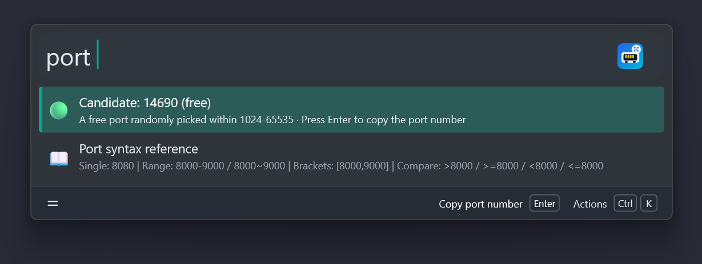

# PortGenerator

A [Wox](https://www.woxlauncher.com/) plugin to **check port usage** and **generate random free ports** on your machine.

## Features

- **Check a single port** — reports whether a specific port is in use (TCP / UDP), free, or unknown.
- **Generate a random free port** — picks an available port from a range you specify.
- **Flexible port syntax** — single port, range, bracket notation, and comparisons (`>8000`, `<=9000`, `8000+`, …).
- **Copy platform-specific check commands** — Windows CMD, PowerShell, macOS/Linux `lsof`, and Linux `ss`.
- **Bilingual UI** — English and Simplified Chinese (follows the Wox language setting).
- Works on **Windows, Linux, and macOS**.

## Screenshot



## Install

```shell
wpm install PortGenerator
```

## Usage

Type the trigger keyword `port` in Wox, followed by a port or a range:

```shell
port 8080
```

- **Single port** (`port 8080`) — shows the current status of that port. Press `Enter` to copy the port number, or open the actions menu to copy a platform-specific check command.
- **Range** (`port 8000-9000`) — previews a randomly chosen free port in the range. Press `Enter` to copy it. Re-query to roll a new candidate.
- **Empty input** (`port`) — uses the default range `1024-65535`.

## Port syntax reference

| Syntax | Meaning | Example | Resolves to |
| --- | --- | --- | --- |
| `PORT` | Single port | `8080` | `8080` |
| `LOW-HIGH` | Inclusive range | `8000-9000` | `8000-9000` |
| `LOW~HIGH` | Inclusive range (`~`) | `8000~9000` | `8000-9000` |
| `LOW..HIGH` | Inclusive range (`..`) | `8000..9000` | `8000-9000` |
| `LOW-` | Open upper bound | `8000-` | `8000-65535` |
| `-HIGH` | Open lower bound | `-9000` | `1-9000` |
| `[LOW,HIGH]` | Closed interval | `[8000,9000]` | `8000-9000` |
| `(LOW,HIGH)` | Open interval | `(8000,9000)` | `8001-8999` |
| `[LOW,HIGH)` | Half-open interval | `[8000,9000)` | `8000-8999` |
| `(LOW,HIGH]` | Half-open interval | `(8000,9000]` | `8001-9000` |
| `>N` | Greater than | `>8000` | `8001-65535` |
| `>=N` | Greater than or equal | `>=8000` | `8000-65535` |
| `<N` | Less than | `<8000` | `1-7999` |
| `<=N` | Less than or equal | `<=8000` | `1-8000` |
| `N+` | Same as `>=N` | `8000+` | `8000-65535` |
| *(empty)* | Default range | *(nothing)* | `1024-65535` |

Full-width symbols (`, ~ > < ≥ ≤ - [ ] ( ) :`) are normalized automatically, so `［8000，9000］` and `≥8000` work as well.

## Examples

| Input | Result |
| --- | --- |
| `port 8080` | Status of port 8080, with copy actions |
| `port 8000-9000` | A random free port between 8000 and 9000 |
| `port >=8000` | A random free port from 8000 to 65535 |
| `port [3000,3010]` | A random free port between 3000 and 3010 |
| `port` | A random free port between 1024 and 65535 |

## Notes & limitations

- **Loopback only.** Port occupancy is probed by binding `127.0.0.1` and `::1` (TCP and UDP). A process bound only to a specific external IP (e.g. `192.168.x.x`) may be reported as free — use the copied `lsof` / `netstat` / PowerShell command to double-check.
- **Privileged ports.** Detecting ports `1-1023` accurately requires administrator/root privileges; otherwise the status is shown as *unknown*.
- **Windows CMD `findstr` is a substring match** — `netstat -ano | findstr :80` also matches `18080`. Use the PowerShell action for exact checks.
- Ports in `TIME_WAIT` are treated as temporarily unavailable (`SO_REUSEADDR` is not set).

## Development

Requires Python ≥ 3.10 and [uv](https://github.com/astral-sh/uv).

```shell
make install   # install dependencies
make lint      # ruff + mypy
make format    # ruff format
make test      # run unit tests
make build     # build the dist/ directory
make package   # produce wox.plugin.portgenerator.wox
```

## License

GPL-3.0 — see [LICENSE](LICENSE).
